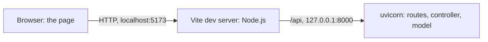

# Token viewer

A token viewer for chat requests: given a model on Hugging Face and a list of chat messages, it shows the exact tokens the model reads. It has two views on the same model and controller classes: a page in the browser, written in TypeScript, and a terminal view.

In class, your group presents what it achieved, in 10 minutes: run it from this README, show what works, follow one click through the processes with breakpoints, and show your AI-use log. Before that, replace every _Yours_ line and every "Starter:" note.

Starter: this repository is a shell that runs end to end before any token logic exists: a fake controller answers every command with made-up data. The task is on the [task sheet](https://github.com/L3GJ0N/engineering_agentic_ai_systems_hs_aalen/blob/main/exercises/token_viewer/README.md) in the course repository, and its [samples](https://github.com/L3GJ0N/engineering_agentic_ai_systems_hs_aalen/tree/main/exercises/token_viewer/samples) hold the course request's messages. Everything the task asks for can be done in Python: the page shows whatever the view-model carries. [GUIDE.md](GUIDE.md) says what the starter provides and what is yours, what to try first, how to debug it, and why its versions are pinned. In the code, notes that begin with `Yours:` mark where your work goes.

## 1. Run everything

Starter: one member of your group creates the group's own repository from this template, with **Use this template > Create a new repository** on this repository's GitHub page, and adds the others as collaborators. Everyone then clones that repository and works there. [GUIDE.md](GUIDE.md#your-groups-repository) has the steps.

Starter: stuck, or want a guide through this section? [SETUP_PROMPT.md](SETUP_PROMPT.md) holds a prompt for a coding agent that checks your tools and runs these steps with you, without changing any code.

You need four tools:

- **Git** to clone the repository: [git-scm.com](https://git-scm.com/downloads) has it for Windows, macOS and Linux; on macOS, typing `git` in a terminal also offers to install it. Check with `git --version`.
- **uv** for Python: see its [installation guide](https://docs.astral.sh/uv/getting-started/installation/). Check with `uv --version`.
- **Node.js 24 LTS or newer** for the page. On Windows and macOS, use the installer from [nodejs.org](https://nodejs.org/en/download). On Linux, use one of the version managers nodejs.org recommends, for example `nvm install --lts`; the `nodejs` package of a distribution is often too old. Check with `node --version`: v24 or newer.
- **VS Code 1.112 or newer** with the extensions the workspace recommends: Python, Python Debugger and Ruff. **Help > About** shows the version (on macOS, **Code > About Visual Studio Code**); the debug configuration **Full stack: back end + browser** needs 1.112.

In WSL, follow the Linux steps inside WSL: clone into the WSL file system, open the clone in a VS Code WSL window, and never share `.venv` or `node_modules` with Windows.

From a fresh clone, open the repository in VS Code as a workspace, not as a folder: **File > Open Workspace from File**, then choose `token_viewer.code-workspace`. Only then does VS Code use the back end's and the page's own settings and debug configurations, **Full stack: back end + browser**, and the setting that keeps editor AI suggestions off. If you opened the folder with **File > Open Folder**, VS Code offers **Open Workspace** in a notification: choose it. When VS Code asks whether you trust the authors, choose **Yes, I trust the authors**: in Restricted Mode, debugging and tasks are switched off. Open **Terminal > New Terminal**; VS Code asks for a folder, so choose **repository**. Then:

```console
cd backend
uv sync
uv run uvicorn token_viewer.api:app --port 8000
```

The back end now listens on <http://127.0.0.1:8000>; <http://127.0.0.1:8000/docs> lists every route. It does not reload: after you change Python code, stop it with Ctrl+C and start it again ([GUIDE.md](GUIDE.md#debugging) says why). Leave it running and open a second terminal, again in **repository**:

```console
cd frontend
npm ci
npm run dev
```

Open <http://localhost:5173>. Starter: the page shows the fake controller's made-up tokens; [GUIDE.md](GUIDE.md#try-the-starter) says what to try first.

The terminal view, in a terminal of its own in `backend`:

```console
uv run token-viewer-terminal
```

It loads the model, sets the course request's messages and prints every token of both views. `--messages file.json` reads other messages, and `--repository` and `--revision` choose another model.

The tests and checks: see [Checks](#checks).

## 2. Process map

While you develop, the page and the back end run in separate processes:



Vite's proxy passes every request under `/api` on to uvicorn, so the page and the API share one origin and need no CORS.

The terminal view is a third process: `uv run token-viewer-terminal` starts its own Python process, which calls `build_controller()` itself. It has its own `TokenController` and `TokenModel`, the same classes as uvicorn's, but its own state. It shares nothing with the page.

The model's files, `tokenizer.json` and `chat_template.jinja`, come from Hugging Face at the pinned revision, on the first **Load model**. They are kept in `backend/downloads/<first 12 characters of the revision>/`, which Git ignores. After that, loading reads them from disk and works offline.

The state (loaded tokenizer, messages, current view, selected token) lives in the `TokenModel` inside uvicorn's process. When uvicorn restarts, that state is gone and the page shows nothing until **Load model** runs again. The downloaded files stay on disk.

The browser debugger attaches to the page in the browser (`main.ts`, `api.ts`). The Python debugger attaches to uvicorn (routes in `api.py`, `TokenController`, `TokenModel`). Vite only passes requests on, so no breakpoint stops there.
## 3. Debugging

Stop the back end from section 1 by closing its terminal (**Kill Terminal**) or with Ctrl+C in it, and keep Vite running. Then select **Run and Debug**, choose **Full stack: back end + browser** and click **Start Debugging**.

Starter: [GUIDE.md](GUIDE.md#debugging) shows where the first breakpoints go and what **Call Stack**, **Variables** and **Network** show there.

_Yours: your breakpoints in the model, where the chat template is rendered and where the text is encoded, and what **Variables** shows there._

If your code ever reads a key or a Hugging Face token, collapse **Variables** before you share your screen.

## 4. What works

**Step 1, terminal view, 24 tokens: works.** Run `uv run token-viewer-terminal` in `backend`. The chat view shows 24 tokens with the same IDs, in the same order, as `uv run tokenize-chat` in token_lab: from `<|im_start|>` (10) to `</think>` (13). `<|im_start|>` and `<|im_end|>` are marked special, while `<think>` and `</think>` are added tokens but not special. The text alone, `Explain tokenization in one sentence.`, gives 8 tokens.

**Step 2, the page: works.** Start the back end and the page as in section 1 and open <http://localhost:5173>.

1. Repository `nvidia/NVIDIA-Nemotron-3.5-Lightning-30B-A3B-NVFP4`, revision `bee7596271d1495f6992ae224aefde4410e816b8`, **Load model**.
2. Messages `[{"role": "user", "content": "Explain tokenization in one sentence."}]`, **Set messages**: 24 tokens, the same as the terminal view, and no "made-up data" notice.
3. **View** "Text alone": 8 tokens, and the selection is cleared.
4. Click a token: **Selected token** shows its index, ID, piece, text, start and end.

The page and the terminal view run at the same time, each in its own process with its own instances. A selection on the page does not affect the terminal view.

**Step 3, emoji and offsets:** not done yet. **Step 4, captures:** not done yet. **Load capture** answers that it is not implemented.

## 5. Architecture

| Role | In this repository | May not |
|---|---|---|
| Model | `token_model.py`: `TokenModel`, which downloads and loads the tokenizer and chat template, renders and encodes, and holds the state | import a view, a UI library or a web framework such as FastAPI |
| Controller | the interface in `controller.py` and your class; `wiring.py` chooses it | render anything (HTML, terminal output) |
| View | the page in `frontend/` with its routes in `api.py`; your terminal view | import the tokenizer libraries, contain domain logic |

Starter: [GUIDE.md](GUIDE.md#the-contract) explains the contract between the view-models and the page, and the two meanings of model and view.

**View-model:** unchanged from the starter. Our controller fills the existing fields, so the page needed no change, and `npm run types` was not needed.

**State:** in `TokenModel`, one instance per process: the repository, revision, tokenizer, template, messages, both views' text and tokens, the current view and the selected index. `TokenController` holds only its model. It checks input, calls one model operation per command, and turns a `TokenModelError` into a `CommandError`.

**View-model:** unchanged from the starter. Our controller fills the existing fields, so the page needed no change, and `npm run types` was not needed.

**State:** in `TokenModel`, one instance per process: the repository, revision, tokenizer, template, messages, both views' text and tokens, the current view and the selected index. `TokenController` holds only its model. It checks input, calls one model operation per command, and turns a `TokenModelError` into a `CommandError`.

**The change that put the page on our controller:** commit `603acfe` changes only `backend/src/token_viewer/wiring.py`, from `FakeController()` to `TokenController()`. The commit before it, `ac052cf`, set it back to the fake to show the "before" state. `git show --stat 603acfe` lists one file. No change to the model, the controller or the page.**View-model:** unchanged from the starter. Our controller fills the existing fields, so the page needed no change, and `npm run types` was not needed.

**State:** in `TokenModel`, one instance per process: the repository, revision, tokenizer, template, messages, both views' text and tokens, the current view and the selected index. `TokenController` holds only its model. It checks input, calls one model operation per command, and turns a `TokenModelError` into a `CommandError`.

**The change that put the page on our controller:** commit `603acfe` changes only `backend/src/token_viewer/wiring.py`, from `FakeController()` to `TokenController()`. The commit before it, `ac052cf`, set it back to the fake to show the "before" state. `git show --stat 603acfe` lists one file. No change to the model, the controller or the page.

## 6. Decisions

- **Files and revision:** only `tokenizer.json` and `chat_template.jinja` from `nvidia/NVIDIA-Nemotron-3.5-Lightning-30B-A3B-NVFP4` at revision `bee7596271d1495f6992ae224aefde4410e816b8`, the same as token_lab, so the IDs match `tokenize-chat`. The weights are not needed.
- **Libraries:** `huggingface-hub` to download, `tokenizers` to encode, `jinja2` (sandboxed) to render the template, the same as token_lab. `transformers` gives the same tokens but is a much larger install.
- **Encoding:** `add_special_tokens=False`, because the chat template already writes every marker. Adding them again would change the count.
- **Text alone:** the message contents joined with a newline, encoded without the template.

Starter: three questions are left open on purpose. Decide them, and record what you chose and why:

- **Template switches.** No command and no view-model field carries the chat template's switches, such as thinking on or off, although the course request sets one. Where do they belong?
- **Offsets.** `TokenView.start` and `TokenView.end` do not say what they count. Which unit do you choose?
- **Capture metadata.** A capture is the file that [capture-nvidia-response](https://github.com/L3GJ0N/engineering_agentic_ai_systems_hs_aalen/tree/main/llm_inference#run-the-project) in the course repository writes. The task lists the metadata a capture should show. Which of them are the provider's statements, and which are your own local reconstruction? How do your views show the difference?

## 7. AI use

Every prompt goes into [AI_USAGE.md](AI_USAGE.md). Editor AI suggestions stay off: the workspace switches off VS Code's inline suggestions and Copilot's next edit suggestions, because they write code without a prompt that could go into the log. Chat stays available for questions and hints.

_Yours: two or three representative prompts from the log, what you learned from each, and what you decided yourselves._

## Checks

Run each block from the repository folder, each in a terminal of its own:

```console
cd backend
uv run ruff check
uv run ruff format --check
uv run mypy
uv run pytest
```

```console
cd frontend
npm run build
npm run types:check
```

Starter: the route tests send requests to the app inside the test process, against the fake controller, and `test_controller.py` checks the controller interface itself; none of them needs a server or the network.

`npm run build` type-checks the page with `tsc` and then builds it. `npm run types` and `npm run types:check` read the description of the running back end, so they need a back end started after your last change to the Python code: restart it first. `npm run types:check` fails when `src/schema.d.ts` no longer matches the view-models.

## Versions

The back end needs Python 3.11 or newer; uv installs Python 3.13, which `backend/.python-version` names, if it is missing. `backend/uv.lock` pins FastAPI 0.159, uvicorn 0.54 and Pydantic 2.14. `frontend/package-lock.json` pins Vite 8.3 and TypeScript 5.9. Keep TypeScript at 5.9: [GUIDE.md](GUIDE.md#versions) says why.

## Troubleshooting

| What you see | Check |
|---|---|
| **Run and Debug** offers no configurations, or no **Full stack: back end + browser** | VS Code opened a folder, not the workspace. Use **File > Open Workspace from File** and choose `token_viewer.code-workspace`: the full-stack configuration exists only there. |
| Starting **Full stack: back end + browser** reports "Configured debug type 'editor-browser' is not supported" | VS Code is older than 1.112. Update it with **Help > Check for Updates** (on macOS, **Code > Check for Updates**). Until then, start **Back end: uvicorn**, then **Front end: browser (Edge)** or **(Chrome)**. |
| **Run and Debug** and the task **uv: sync** do nothing, and the status bar says **Restricted Mode** | You chose not to trust the folder. Click **Restricted Mode** and choose **Trust**: it is your group's code. |
| The page says "Waiting for the back end…" | Expected while the back end works on a command or waits at a breakpoint. At a breakpoint, click **Continue** in the debug toolbar. |
| The page says "Waiting for the back end to start (HTTP 502)…" or "The back end does not answer (HTTP 502).", or a command fails with HTTP 502 | The back end is not running; Vite's terminal shows "http proxy error". Start it (section 1) or the debugger (section 3). On the first load, the page keeps asking for 20 seconds; after that, click **Retry**. After a failed command, send it again. |
| The page says "No answer from the page's server. Is npm run dev still running?", or <http://localhost:5173> does not load | Vite is not running, and no debug configuration starts it. Start it in a terminal in `frontend` with `npm run dev`. |
| <http://127.0.0.1:8000> answers `{"detail":"Not Found"}`, or <http://127.0.0.1:8000/docs> stays blank | Expected: no route serves `/`. The page at `/docs` loads its scripts from cdn.jsdelivr.net, so it needs the internet. |
| A command fails with HTTP 500 | Python raised an exception: a bug. uvicorn prints the traceback in its terminal; under the debugger, that is the terminal **Python Debug Console**. |
| Python breakpoints never stop, but the page works | Another back end still holds port 8000, so the debugger's uvicorn stopped at once; its terminal shows "error while attempting to bind on address". Click **Stop**, stop the other back end with Ctrl+C in its terminal or by closing that terminal (**Kill Terminal**), and start debugging again. |
| uvicorn stops with "error while attempting to bind on address ('127.0.0.1', 8000)" | Another back end already runs on port 8000, in a terminal or under the debugger. Stop it with Ctrl+C in its terminal, by closing that terminal (**Kill Terminal**), or with **Stop** in the debug toolbar. On Windows the message goes on with "[winerror 10048]" and a text in the language of Windows. |
| `npm run dev` stops because port 5173 is in use | Another Vite server is still running. Stop it with Ctrl+C in its terminal, or close that terminal (**Kill Terminal**). |
| `npm run types` or `npm run types:check` stops with "ResolveError: fetch failed" and "ECONNREFUSED 127.0.0.1:8000" | The back end is not running. Start it, then run the command again. |
| On Windows, PowerShell refuses to run `npm` with a message that points to `about_Execution_Policies` (in English: "running scripts is disabled on this system") | Type `npm.cmd` instead of `npm`, or allow local scripts for your Windows account with `Set-ExecutionPolicy -Scope CurrentUser RemoteSigned`; this setting stays until you change it. |
| On Windows, `npm ci` fails with EPERM, or `uv sync` fails with "os error 32" | Vite or the back end still runs and holds a file. Stop it with Ctrl+C, by closing its terminal (**Kill Terminal**) or with the debug toolbar's **Stop**, then run the command again. |
| On Windows, `uv run mypy` stops with "DLL load failed while importing mypy", followed by a text in the language of Windows (in English: "The filename or extension is too long"), `uv run ruff check` with "os error 3", or Git with "Filename too long" | The clone lies too deep for the Windows path limit. Clone it into a short folder, such as `C:\Users\<name>\repos\token-viewer`, outside OneDrive. |
| A terminal does not know `uv` or `npm`, or the task **uv: sync** cannot find uv | Restart VS Code after installing uv or Node.js, so that its terminals and tasks get the new PATH. Then check with `uv --version` and `node --version`. |
| **Front end: browser (Edge)** or **(Chrome)** reports "Unable to attach to browser" or "Could not find any debuggable target", or the browser is not installed | Use the integrated browser, as **Full stack: back end + browser** does. On some Windows setups Edge restarts itself in a new process when VS Code starts it, and the debugger loses it. |
